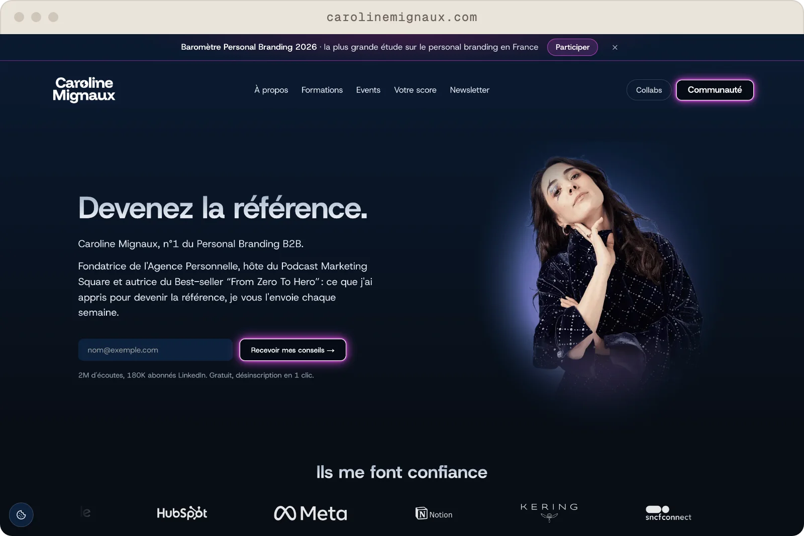
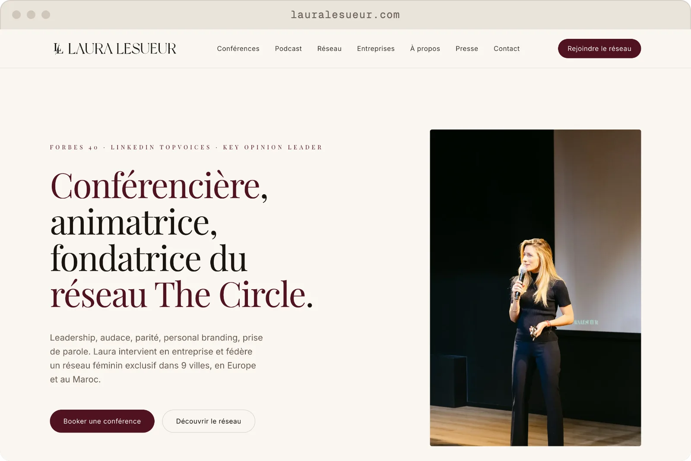

<picture>
  <source media="(prefers-color-scheme: dark)" srcset="assets/carte-sombre.svg">
  
</picture>

Cette carte, c'est mon année de travail. Chaque journée sur GitHub soulève le terrain, l'équation de la chaleur lisse le relief, les courbes de niveau en font une carte. Elle se recalcule chaque lundi : un reste de mes années de physique.

Je dirige **[Socium Web](https://www.sociumweb.com)**, une agence web en Provence. On conçoit des sites qui font venir des clients, on les fait trouver sur Google, et on construit les outils qui font gagner du temps à ceux qui s'en servent. 40 projets à ce jour.

## Ce qu'on fait

- **Sites sur mesure**, en Next.js ou Nuxt, pensés pour convertir : le message, le design, la vitesse.
- **Refontes et migrations** depuis WordPress ou Shopify, redirections et référencement compris.
- **Référencement** : on part de Search Console, Ahrefs et PostHog, et on mesure ce que chaque changement rapporte.
- **Outils métier et API** : tableaux de bord, automatisations, logiciels internes.
- **Renfort technique pour les agences**, en marque blanche.

## Réalisations

<table>
<tr>
<td width="50%" valign="top"> <b>Caroline Mignaux</b> Le site de la fondatrice de l'Agence Personnelle · Next.js, Sanity</td>
<td width="50%" valign="top"> <b>Marketing Square</b> Le site de son podcast · Next.js</td>
</tr>
<tr>
<td width="50%" valign="top"> <b>Sereaum</b> La boutique d'eau de mer en cure · Next.js, Shopify</td>
<td width="50%" valign="top"> <b>Valentine Zeller</b> Breathwork : séances, formation, boutique · Next.js</td>
</tr>
<tr>
<td width="50%" valign="top"> <b>Laura Lesueur</b> Conférencière, fondatrice du réseau The Circle · Next.js</td>
<td width="50%" valign="top"> <b>Hop4lead</b> Incubateur de performance collective · Next.js</td>
</tr>
<tr>
<td width="50%" valign="top"> <b>Christina Aleixo</b> Stratégie marketing et neuromarketing · Nuxt, GSAP</td>
<td width="50%" valign="top"> <b>Valyo</b> Le logiciel immobilier que j'ai cofondé : le site et l'appli · Next.js, Supabase</td>
</tr>
</table>

Les autres projets sont sur [sociumweb.com/projets](https://www.sociumweb.com/projets).

## Comment on travaille

- **Mesurer avant de changer.** Les chiffres disent où agir, puis si ça a marché.
- **Écrire la doctrine.** Copy, design, SEO, produit : les règles vivent dans des fichiers versionnés, que nos agents IA (Claude Code) lisent avant d'agir.
- **Simplifier plutôt qu'ajouter.** Retirer un outil vaut souvent mieux qu'en brancher un de plus.

> « Il a pris le temps de comprendre les enjeux business derrière le site, pas seulement l'esthétique ou la technique. »
>
> Caroline Mignaux, entrepreneure, podcasteuse et LinkedIn Top Voice

## Vous êtes

- **une entreprise dont le site ne rapporte pas assez** : [réservez un échange offert](https://calendly.com/socium_web/appel-decouverte) ;
- **une agence qui cherche un renfort technique** : [écrivez à Socium Web](mailto:contact@sociumweb.com).

## Aussi

Cofondateur de **[Valyo](https://www.valyo.immo)**, le logiciel immobilier des agences, avec Damien Bacon. Avant le web : les maths et la physique théorique, jusqu'à la modélisation numérique au CEA.

Next.js · React · Nuxt · TypeScript · Node.js · NestJS · Laravel · PostgreSQL · Supabase · Vercel · Claude Code

[LinkedIn](https://www.linkedin.com/in/cyril-julien/) · [Instagram](https://www.instagram.com/cyril__julien/) · [cyriljulien.com](https://www.cyriljulien.com)
