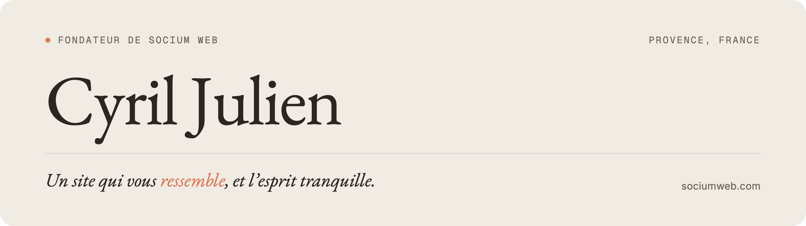
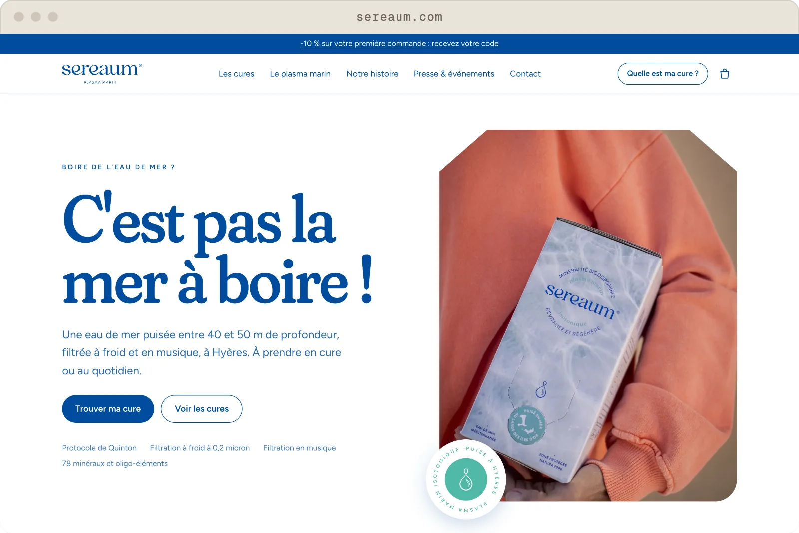
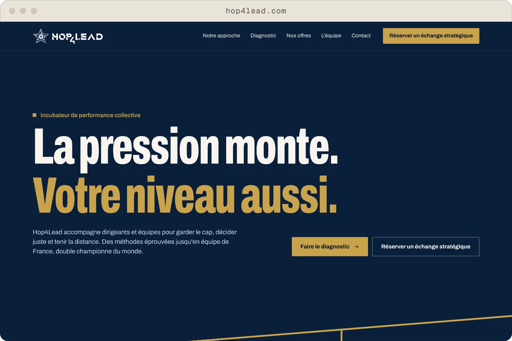
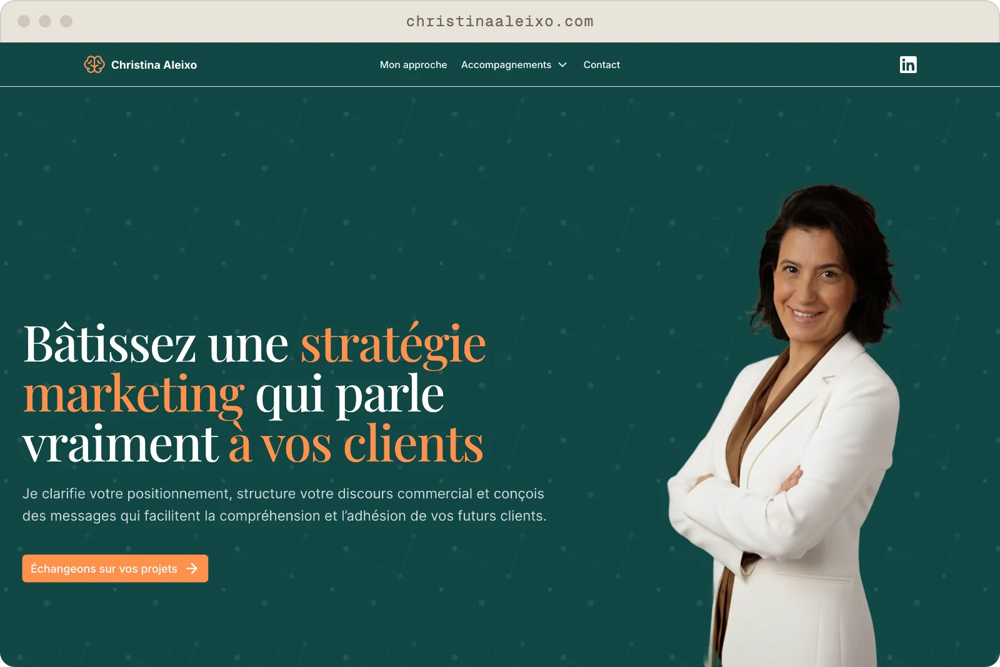

<picture>
  <source media="(prefers-color-scheme: dark)" srcset="assets/banniere-sombre.png">
  
</picture>

 

Je dirige **[Socium Web](https://www.sociumweb.com)**, une agence web près d'Aix-en-Provence. On crée des sites qui vous ressemblent et qui transforment vos visiteurs en clients. Et le site n'est que le début : hébergement, mails, sécurité, suivi, on s'occupe de tout ce qui gravite autour pour vous libérer la tête.

## Ce qu'on fait

- **Site vitrine** : votre présence professionnelle complète, sur mesure.
- **Landing page** : une page de vente pour un lancement ou une offre.
- **E-commerce** : votre boutique en ligne, avec paiement sécurisé et gestion des stocks.
- **Application web** : espace client, tableau de bord, automatisations, sur devis.

Un coup de main ponctuel ? **Socium Flash** pour débloquer une situation en une session, **Socium Time** pour des heures à la demande, **Socium Pass** pour avancer en continu. Les tarifs sont affichés sur [sociumweb.com/tarifs](https://www.sociumweb.com/tarifs).

## Réalisations

<table>
<tr>
<td width="50%" valign="top"> <b>Caroline Mignaux</b> Le site de la fondatrice de l'Agence Personnelle · Next.js, Sanity</td>
<td width="50%" valign="top"> <b>Marketing Square</b> Le site de son podcast · Next.js</td>
</tr>
<tr>
<td width="50%" valign="top"> <b>Sereaum</b> La boutique d'eau de mer en cure · Next.js, Shopify</td>
<td width="50%" valign="top"> <b>Valentine Zeller</b> Breathwork : séances, formation, boutique · Next.js</td>
</tr>
<tr>
<td width="50%" valign="top"> <b>Laura Lesueur</b> Conférencière, fondatrice du réseau The Circle · Next.js</td>
<td width="50%" valign="top"> <b>Hop4lead</b> Incubateur de performance collective · Next.js</td>
</tr>
<tr>
<td width="50%" valign="top"> <b>Christina Aleixo</b> Stratégie marketing et neuromarketing · Nuxt, GSAP</td>
<td width="50%" valign="top"> <b>Valyo</b> Le logiciel immobilier que j'ai cofondé : le site et l'appli · Next.js, Supabase</td>
</tr>
</table>

Les autres projets sont sur [sociumweb.com/projets](https://www.sociumweb.com/projets).

## Comment ça se passe

1. **On commence par vous écouter.** Un premier échange offert pour comprendre votre activité, vos blocages et vos priorités.
2. **Vous recevez un plan d'action.** Ce qu'on fait, dans quel ordre, et pour quel prix.
3. **On crée votre site ensemble.** Un seul interlocuteur, et un espace client où vous suivez l'avancement, le temps passé et votre solde en temps réel.
4. **On reste là.** Hébergement, mises à jour, sauvegardes, sécurité : vous n'avez plus à y penser.

## Ils en parlent

> « Cyril ne s'est pas contenté d'exécuter. Il s'est investi à 2000 %. Il a pris le temps de comprendre les enjeux business derrière le site, pas seulement l'esthétique ou la technique. »
>
> **Caroline Mignaux**, entrepreneure, podcasteuse, LinkedIn Top Voice

> « Travailler avec Cyril est un vrai soulagement. Il m'accompagne au quotidien et son travail me fait gagner un temps précieux. »
>
> **Cristela de Oliveira**, Yunity Agency

> « On ne laisse plus traîner ces petits tracas du quotidien quand on a Cyril pour les régler en 1 h ! »
>
> **Coraline Deshaies**, Ta partenaire CEO

 

<a href="https://www.linkedin.com/in/cyril-julien/"><picture><source media="(prefers-color-scheme: dark)" srcset="assets/icones/linkedin-sombre.svg"></picture></a> &nbsp;&nbsp; <a href="https://www.instagram.com/cyril__julien/"><picture><source media="(prefers-color-scheme: dark)" srcset="assets/icones/instagram-sombre.svg"></picture></a> &nbsp;&nbsp; <a href="https://www.cyriljulien.com"><picture><source media="(prefers-color-scheme: dark)" srcset="assets/icones/site-sombre.svg"></picture></a> &nbsp;&nbsp; <a href="mailto:contact@sociumweb.com"><picture><source media="(prefers-color-scheme: dark)" srcset="assets/icones/mail-sombre.svg"></picture></a>

 

---

Cofondateur de **[Valyo](https://www.valyo.immo)**, le logiciel immobilier des agences, avec Damien Bacon. Avant le web : les maths et la physique théorique, jusqu'à la modélisation numérique au CEA.

<picture>
  <source media="(prefers-color-scheme: dark)" srcset="assets/stack-sombre.svg">
  
</picture>
